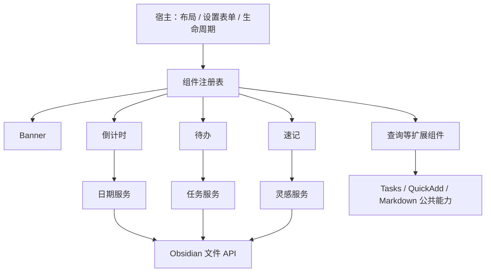

# Home Widgets

你的首页现在是一个独立 Obsidian 插件。Banner、倒计时、待办、速记等都是注册到宿主的小组件，每个类型有自己的 JavaScript、CSS 和设置字段，内置组件只有分类待办支持多实例，其余组件在整个知识库中各保留一个实例。

开发时请先阅读 [开发注意事项](开发注意事项.md)，其中记录界面问题及后续实现必须遵守的约定。

分类待办已支持二级子待办与同级排序，完整规则见 [子待办与拖拽排序设计](子待办与拖拽排序设计.md)。

点击主待办旁的加号可就地添加子项，Enter 或“添加”保存一条后关闭输入区，再次点击加号可继续添加；Esc 退出，保存失败保留草稿。添加区上方整行输入内容，下方左侧为紧凑日期框，日历按钮内嵌于日期框右侧，“添加／取消”按钮靠右排列。父项旁的箭头用于折叠，进度如 `1/3` 表示子项完成数量。勾选父项会完成整组，取消父项会整组恢复未完成；完成最后一个子项会自动完成父项，单独恢复一个子项只恢复它和父项。重复待办保持独立使用。

按住行尾的排序手柄拖动，或聚焦手柄后使用 Alt + 上下方向键调整顺序；Esc 取消拖拽。主项只在同一完成分区内排序，整组一起移动，子项只在同一父项下排序。单独勾选子项完成时，会带上其说明移到该组末尾；取消完成保留当前位置，父项整组勾选不重排子项。顺序保存到笔记，并同步到同源组件；日期只作提示。显示上限按主待办组数计算，组内子项完整显示。

完成后可手动隐藏单个子项或整组，标题栏还原按钮仅恢复显示。隐藏和折叠按组件独立保存，取消完成会清理同一布局内相应的隐藏记录。卡片、今日概览和完成热力图只统计最末级待办：父项有 3 个子项时算 3 件，折叠、隐藏或显示上限不影响总数。

未完成待办直接显示，不显示分区标题。点击“已完成”分区标题可收起或展开整个已完成列表，旁边显示该区的主待办组数，默认展开并按当前组件记住状态。折叠不改变完成状态、统计或隐藏记录，未完成父项下的已完成子项仍保留在原组内。标题栏还原隐藏待办时会展开已完成区，方便直接查看恢复的任务。

同一笔记的变化仍会同步至相关待办，但读取完成前保留旧界面；当前分类内容不变时保留已有列表和操作节点，更新任务快照即可。重复刷新请求合并执行，避免先清空再等待读取造成卡片闪烁。

## 最需要的基础插件

| 基础能力 | 插件 | 推荐程度 | Home Widgets 如何使用 |
| --- | --- | --- | --- |
| 截止日、重复任务、自定义状态 | Tasks | 任务能力首选，当前库尚未安装 | 普通待办在可用时通过 Tasks API 转换状态，并原子写回原笔记 |
| 模板化采集、多步录入、命令流程 | QuickAdd | 按采集需求启用，当前库尚未安装 | 命令组件和速记组件可以调用命名 Choice，传入 value、area 等变量 |
| 启动默认首页 | Homepage | 已启用，继续保留 | 启动时打开 `homepage.md`；不参与布局、查询和写回 |
| 复杂模板脚本 | Templater | 可选，当前库已启用 | 可通过 Obsidian 命令或 QuickAdd 流程触发；未做专用 API 适配 |

Obsidian 原生 API 提供文件、属性缓存、命令、Markdown 渲染及生命周期。Home Widgets 只硬依赖 Obsidian；Banner、倒计时、普通待办、原生速记不需要额外插件。Tasks、QuickAdd 按能力接入，缺失时只影响对应组件。

当前没有引入 Pixel Banner、Buttons、Meta Bind 或其他布局插件：这些功能已由组件与宿主承担。也没有自动安装 Tasks、QuickAdd，避免提前引入你尚未配置的数据流程。

来源与 API 依据：

- [Obsidian 官方 API](https://github.com/obsidianmd/obsidian-api)
- [Obsidian 生命周期与渲染归属](https://docs.obsidian.md/plugins/guides/lifecycle-management)
- [Tasks 插件维护者对状态切换 API 的说明](https://github.com/obsidian-tasks-group/obsidian-tasks/discussions/3479)
- [Tasks API 返回文本、不会自行改文件](https://github.com/obsidian-tasks-group/obsidian-tasks/issues/3287)
- [QuickAdd API](https://quickadd.obsidian.guide/docs/QuickAddAPI/)

## 打开首页

构建产物已放入本库 `.obsidian/plugins/home-widgets/`。重新加载 Obsidian 后，确认第三方插件中 Home Widgets 已启用，再打开 `homepage.md` 阅读视图。Homepage 会继续使用相同首页文件。

首页只保留声明：

````markdown
```home-widgets
layout: Home/widgets.json
```
````

无需 DataviewJS、新建函数或在笔记里拼页面。整个知识库只使用 `Home/widgets.json`，指定其他布局路径会明确报错。同一首页在多个窗口打开，共享实例配置，各自管理渲染生命周期。

本地预览：[http://127.0.0.1:4319/](http://127.0.0.1:4319/)。它与插件共用组件源代码，直接读写本库；依赖 Obsidian 运行时的 Tasks/QuickAdd 集成会提示需要在 Obsidian 中使用，浏览器不会伪造查询结果。

## 组件与实例

类型定义决定“这个组件能做什么”；实例保存“这张卡片的配置是什么”。工作、学习、生活是同一种 tasks 组件的三个实例。Banner 也是组件，可以排序、隐藏、配置，单实例类型已添加时提供定位或恢复入口。

| 类型 | 职责 | 设置示例 |
| --- | --- | --- |
| banner | 图片与欢迎信息 | 图片、标题、副标题、每日引言库、固定／备用引言、高度、垂直焦点、日期开关 |
| countdown | 关键日期 | 按名称选择置顶日期、折叠时显示数量（0 = 全部） |
| tasks | 分类待办 | 数据笔记、分类、是否显示已完成、显示上限 |
| capture | 灵感速记 | 保存目录、提示词、可选 QuickAdd Choice |
| ideas | 灵感收件箱 | 数据目录、每次显示条数、全文搜索、全部/待整理/归档筛选 |
| shortcuts | 快捷入口 | 笔记入口列表 |
| summary | 统计概览 | 待办来源、灵感目录、一句话 |
| heatmap | 可切换统计的活动热力图 | 默认数据源、近 13 周／本月、笔记目录、待办笔记 |
| command | 命令与 QuickAdd 流程 | 按钮文字、命令 ID、Choice 名称 |

灵感速记采用带副标题的 SVG 图标标题栏，以及一体式输入区和底部操作栏。分类可直接点击「未分类／工作／生活／学习」切换；纯文字快捷键位于分类和保存按钮之间，窄屏自动换行。输入框、分类标签或保存按钮获得焦点时，按 Ctrl/⌘ + Enter 均可保存；输入法选字期间不会触发，焦点移出组件后释放快捷键。保留按实例隔离的本地草稿和可选 QuickAdd 流程；保存失败或保存期间继续输入时保留未提交的新内容。

倒计时以主日期卡片和日期牌展示重点，天数靠左大字显示。主卡片与每条日期旁的图钉均可设置置顶，已置顶的主卡片再次点击图钉可取消；组件设置里的「置顶日期」按名称和日期选择，无需填写 ID。新组件默认「自动选择」最近未到期的日子（包含今天），全部已结束时显示最近结束的日子；主卡片标记当前为「置顶」或「自动选择」。置顶仅影响当前组件，布局编辑期间的置顶调整随布局保存或放弃。删除置顶日期后自动清除失效引用并恢复自动选择，全部删除后重新添加的日期仍可直接置顶。

主卡片保留右侧日期牌，不再重复显示底部日期行。其他日期附带日期、星期和「今天／明天」提示，未来日期优先显示。默认展示全部未归档日期，仅下方「其他日子」列表独立滚动，主卡片保持固定；若配置折叠数量，列表仍提供「查看全部／收起」和总数。主卡片与每条日期都有垃圾桶按钮，弹窗中可选择「归档」「取消」或「删除日期」：归档保留记录但隐藏，删除永久移除记录。归档日期不参与主卡片、其他日子、计数与置顶选择；归档置顶日期时恢复自动选择。日期归档状态随唯一列表保存，打开首页的其他视图同步更新。

有归档记录时，标题栏在「添加」左侧显示归档 SVG 图标，右上角数字角标表示归档数量；点击后按日期名称选择并「恢复显示」。即使全部日期都已归档，此入口仍保留。恢复保留原日期 ID、名称、目标日期和分类，原有置顶不会自动恢复。归档、恢复和删除会检查记录是否已被其他操作修改；保存失败保留原数据并允许重试。

倒计时通过 Obsidian 的 `loadData()` / `saveData()` 保存至 `.obsidian/plugins/home-widgets/data.json` 的 `countdowns: { version: 2, events: [...] }`。只有一份独立日期列表，日历来源日期在内存中合并展示，不复制业务字段。插件设置与日期写入共用保存队列。旧集合格式须在备份后一次性整理，正式运行时不迁移、不降级。

首页统一通过顶部「＋ 添加组件」新建实例：选择任意组件类型，进入默认配置表单后点击「创建实例」才添加；分类待办可重复创建；其余内置类型已存在时显示「已添加」，可定位或恢复隐藏实例。取消表单不会留下实例。新实例使用类型的默认配置，名称、宽高和设置可独立调整。插件设置的内置组件、外部插件类型页也提供「＋ 新增实例」，不必先在首页添加。

快捷入口默认保留「灵感收件箱」「全部待办」「插件指南」三个入口，已移除旧的「关键日期」笔记入口。

「隐藏」保留实例配置，可用「恢复隐藏」找回；垃圾桶「删除实例」会先确认，再移除该实例及其配置。删除待办组件时，会额外询问如何处理该源文件、该分类的全部任务；其他组件的关联笔记、日期和灵感内容保留。隐藏或断开连接的实例也可以在插件设置页删除。设置页的创建、删除确认后直接保存；首页编辑布局中的操作先进入草稿。隐藏和外部插件断开均不释放单实例名额；删除实例并保存后才能重新创建。创建、草稿提交与布局加载均验证实例数量，遇到冲突保留全部数据并报错。

待办组件的删除弹窗显示源文件、分类、全部任务数量和共享此分类的其他实例。默认「保留任务，转为未分类」，任务留在原文件，使用明确的 `#area/uncategorized` 标签，保留勾选状态、日期、块 ID 及说明，不再被工作、生活或学习分类组件读取。选择「同时删除此分类的全部任务」会删除匹配分类的任务和所属说明，包含已完成、已隐藏或未在当前列表展示的条目；其他分类的任务及其子块保留。其他读取相同分类的组件会同步变化。

首页编辑时，任务处理也先进入草稿，保存退出才执行，不保存退出则保留原组件和任务。若确认后的任务文件发生变化，会停止保存并要求重新确认，避免误处理新增或修改的任务。多个文件写入中途失败时会尝试恢复已改动的文件；如文件又被外部修改，停止覆盖并将原文保存到提示的 `HomeWidgets/recovery/` JSON 文件。

活动热力图采用紧凑标题栏，右侧可切换「笔记活动／任务完成」。统计、时间范围、日历色块和色阶随数据源更新，日期数量仅在悬停或聚焦色块时提示，不显示底部日期明细行。设置支持近 13 周和本月；笔记按创建时间计数，可指定目录，留空统计整个知识库。文件复制或同步后的创建时间取决于文件系统，不代表完整历史编辑记录。

热力图使用横向扁平色块，自适应高度时色块宽高比为 2.6:1，随组件宽度缩放。设置固定高度后，列宽与行高分别铺满可用宽高，扣除标题、统计和图例后的剩余空间由热力图占满，不保留居中留白。近 13 周和月历均使用 CSS 网格即时响应组件尺寸变化。

任务按 `✅ YYYY-MM-DD` 或 `[completion:: YYYY-MM-DD]` 完成日期计数；缺少完成日期时不推测，图例左侧提示未计入数量。在未启用 Tasks 转换 API 时，首页勾选任务会写入本地当天的完成日期，重新打开任务会移除完成日期，编辑任务保留日期；启用 Tasks 时继续尊重其原生转换结果。浏览器预览读取真实笔记创建时间和任务内容。

后续习惯或其他指标可通过 `home-widgets.api.registerActivitySource({ id, label, unit, legend, load })` 接入，无需改热力图。`load({ io, config, start, end, signal })` 返回 `{ values: [{ date: 'YYYY-MM-DD', value: 1 }], note?: '提示' }`；同日值自动累加，非法日期、负数和范围外记录不计入。返回的注销函数应归属调用插件的卸载生命周期。数据源的增删、笔记变化、跨天会更新热力图；切换选择按实例在本次会话中保留，设置中的默认数据源在重启后生效。

进入「编辑布局」后，排序、宽高、隐藏、添加、删除和组件配置先保留为本次草稿。按 Esc 或点击「完成编辑」会询问是否保存：选择「保存并退出」才写入布局；「不保存并退出」恢复已保存的布局；「继续编辑」或关闭弹窗则保留当前草稿。组件设置等子弹窗打开时，Esc 优先关闭该弹窗。任务、日期和灵感等笔记内容仍按各自的保存操作写入。

## 解耦约定

### 待办与灵感的存放

`Home/待办.md` 在管理区域中按「工作／生活 → 未完成／已完成」组织。首页新增、编辑、勾选、恢复、删除以及移除分类都会重新整理分组，保留任务的日期、块 ID 和缩进子项。管理区域由 `<!-- home-widgets:tasks -->` 与 `<!-- /home-widgets:tasks -->` 标识，说明文字放在区域外；区域内发现无法归类的自由正文时停止写入，避免丢失内容。普通来源笔记未设置管理区域时，仍按原有 Markdown 任务方式写回。

灵感正文位于 `Inbox/Ideas/`，一条一篇。速记使用正文第一行作为标题与文件名，自动处理文件名禁用字符，同名文件按「主题（2）.md」继续编号，创建失败保留速记草稿。现有六篇灵感已按标题重命名，正文、属性与归档状态保留。

`Home/灵感索引.md` 使用 `focus: ideas` 入口打开并定位唯一首页收件箱；隐藏时恢复原实例，不创建第二份布局。首页收件箱保留全文搜索、状态筛选及归档恢复，每次显示 20 条。原 `Home/ideas.json` 已备份归档；浏览器预览也拒绝其他布局路径。



1. 组件只修改自己的 `ctx.el` 和 `ctx.actions`，不查询兄弟组件的 DOM。
2. 组件不导入其他组件，也不直接访问 `app.plugins`。
3. 每个组件声明自己关心的文件/目录，宿主只刷新对应组件。编辑中的表单会延后刷新；速记不订阅待办更新。
4. 计时器、事件监听、第三方渲染子组件都归属自己的 lifetime；移除、重配或卸载时清理。
5. 待办和灵感内容放在 Markdown，倒计时放在插件 `data.json`，布局放在 `Home/widgets.json`，临时 UI 状态按实例隔离。灵感草稿按知识库和实例保存在设备本地。
6. 每个 CSS 文件使用 `[data-widget-type="类型"]` 限定作用域。单实例覆盖还可以使用 `[data-widget-id="实例ID"]`。
7. 一个组件发生异常只显示自己的重试状态，其他组件继续使用。

## 微调单个组件

所有组件的设置、新增实例表单在桌面端使用最大 920px 的宽弹窗，短字段两列排列；图片路径、多行文本与 CSS 样式类占整行。标题栏和保存按钮保持可见，内容在表单内滚动；窗口宽度不超过 680px 时自动切回单列。首页与插件设置页使用相同样式。

Banner 默认使用 `Home/assets/home-cozy-banner.png` 的参考插画，搭配奶白底色、手写 HOME、小屋图标与淡紫引言卡。右侧插画内的文字属于图片本身。默认高度 210px、关闭日期；窄屏改为上方插画、下方文案，内容可自然撑高。

Banner 通常由组件设置中的「高度」控制整体尺寸；如果在编辑布局中拖动底边设定外层固定高度，插画也会填满可用高度，避免底部留下空白。双击底边可恢复由内容决定高度。

每日引言通过 Banner 引言框右上角的铅笔进入「引言库」管理，支持搜索、添加、多行编辑和删除确认。日常无需打开底层文档。内容仍保存在 `Home/引言库.md`：每个顶层列表项是一条，续行缩进两个空格或一个 Tab。普通说明、标题、笔记属性和代码块不参与选择，重复引言只计一次。管理界面保留其他引言和说明原文；遇到外部修改时停止保存或删除并保留编辑草稿，可重新载入后再操作。引言按纯文字显示，不执行 HTML 或 Markdown。默认提供 12 条示例。

按设备本地日期和引言库路径确定当天的随机选择，同一库当天刷新或重启仍显示同一句，无需另存每日状态；引言库保持一致时，同一首页的多个视图也显示相同内容。修改引言库后自动重新读取，当天选句可能随库内容变化。首页保持打开时每分钟检查跨天，窗口重新获得焦点或可见状态变化时也会检查。悬停或聚焦引言框右上角的铅笔可打开管理界面；手机上直接显示该按钮。

组件设置中的「每日引言库」可改为其他笔记路径，留空则使用「固定／备用引言」；两者都留空时隐藏引言框。库文件缺失、为空或读取失败时保留 Banner 插画和备用引言，并显示具体提示与管理入口；仅打开首页不会写入引言库。文件缺失时，在管理界面明确保存第一条引言才会创建文件。

引言框右上角的循环箭头是「随机换一句」按钮，从同一引言库立即选出另一句，有两条以上不同引言时不会重复当前内容。库内只有一条、为空或读取失败时禁用；固定引言模式不显示。在「每日自动」模式中，随机切换的结果按知识库、Banner 实例和引言库路径保存在当前设备，当天刷新或重新打开仍保留；跨天恢复每日选句，所选引言被删除后也恢复自动选择。设备存储不可用时在当前会话中保留选择，不修改引言库或布局文件。

管理界面提供「每日自动／手动设置」。切换到「手动设置」后，在目标引言下点击「设为首页引言」即可应用并关闭管理界面。模式和选中原文通过当前 Banner 实例的 `quoteMode`、`selectedQuote` 保存在布局配置中，重启或跨天仍保留，随唯一 Banner 实例保存；点击「每日自动」恢复自动选句。手动模式下随机切换会保存新的固定选择。选中的引言若被修改或删除，首页暂时显示每日一句并提示重新选择。选择前重新读取引言库，避免应用已删除或已修改的陈旧内容；保存失败时保留管理界面与原配置。

引言按钮只使用 `aria-label` 提供无障碍名称和 Obsidian 提示，不叠加原生 `title` 提示；引言卡片的日期信息使用 `aria-description`，避免按钮悬停时继承父级原生提示。

引言文字在卡片内水平、垂直居中，左右预留相同空间。随机和编辑按钮在鼠标移入引言框时一起出现，移出后隐藏；键盘聚焦时也显示，触屏设备保留直接可见的入口。

```text
HomeWidgets/
  src/
    main.js                    Obsidian 入口、命令与设置页
    widget-contract.d.ts        组件接口说明
    core/                      注册表、宿主、表单、事件总线、生命周期
    adapters/                  Obsidian 文件和第三方插件适配器
    services/                  任务、日期、灵感、布局服务
    widgets/
      banner/index.js          Banner 渲染、默认配置与字段
      banner/styles.css        Banner 样式
      countdown/index.js       倒计时渲染、默认配置与字段
      countdown/styles.css     倒计时样式
      ...
  examples/quote-widget/       最小新组件范例
  scripts/                    构建、部署、本机预览
  tests/                      数据完整性、模块边界和适配器检查
  build/                      可安装产物与浏览器共享构建
```

旧版首页原型、历史插件备份和旧安装包已集中归档到 vault 根目录的 `.legacy-archive/legacy-home-2026-10-18.zip`，不再散放于工作目录。归档说明与恢复方法见 `.legacy-archive/README.md`；当前 `preview/` 界面截图、预览入口、源码和测试继续保留。

例如调整 Banner：

- 日常换图或文字：进入编辑布局 → Banner 齿轮，不需要改代码。
- 微调排版：修改 `src/widgets/banner/styles.css`。
- 增加 Banner 功能：修改 `src/widgets/banner/index.js` 的 defaults、fields、mount。

在 `HomeWidgets` 目录运行：

```powershell
npm test
npm run deploy
```

部署会自动构建并复制 main.js、styles.css、manifest.json；无需 npm install。之后在 Obsidian 中关闭再启用 Home Widgets，或重新加载应用。浏览器预览刷新即可使用新的构建。

不想构建时，可以在 Obsidian CSS snippet 中覆盖单个实例，例如：

```css
.hw-home [data-widget-id="banner-main"] h1 {
  letter-spacing: 10px;
}
```

## 增加新类型

将 `examples/quote-widget/` 复制到 `src/widgets/quote/`，然后在 `src/widgets/index.js` 的 builtins 列表增加 `require('./quote')`。运行部署后，它会自动出现在“添加组件”里，设置表单根据 fields 生成；宿主不需要增加类型判断。

统一契约为：

```javascript
module.exports = {
  supportsMultipleInstances: false, // 缺省即为单实例；提供方可明确声明 true
  type: 'quote',
  label: '一句话',
  defaults: { text: '慢慢来，也是一种前进。' },
  fields: [{ key: 'text', label: '内容', type: 'textarea' }],
  watch: settings => [],
  mount(ctx) {
    const p = ctx.doc.createElement('p');
    p.textContent = ctx.config.text;
    ctx.el.append(p);
  }
};
```

不要在组件内自行 `setInterval`：使用 `ctx.lifetime.interval(fn, ms)`。异步读取后先检查 `ctx.signal.aborted`，避免组件移除后继续写 DOM。

其他受信任的自有插件可通过 API v3 的 `home-widgets.api.registerWidget(definition, { pluginId, pluginName })` 注册类型，两个参数及来源中的两个字段均必需。返回值是注销函数，调用方在自己的卸载回调里调用它。调用方必须检查 `api.version === 3`；不接受一参数注册或其他 API 版本。这个 API 是代码扩展入口，不会执行笔记中的任意组件脚本。

设置页分为「通用」「内置组件」「外部插件」。内置组件由 Home Widgets 实现；Dataview 查询、Tasks 查询和 Markdown 嵌入三个独立组件已移除。其他插件通过公开 API 注册的类型归入「外部插件」，例如 MyCalendar；插件断开后，已有实例仍显示在此栏并保留配置。实例卡片右侧开关只控制该实例在首页显示或隐藏。

「通用 → 字体与排版」提供首页字体、正文字号、正文行距、排版预览和恢复默认。默认使用 Noto Sans SC、15px、1.75 倍行距；可选跟随笔记字体、跟随界面字体，或输入已安装的自定义字体名称。字号可设为 12–24px，行距可设为 1.2–2.4；跟随字体只改变字族，字号与行距仍可独立选择。下拉选项自动保存，自定义字体名称在离开输入框后保存。

排版保存在 `Home/widgets.json` 的可选 `typography` 中，未指定或恢复默认时使用默认值。更改排版会同步到打开的首页，不重新挂载组件、不影响普通笔记。样式源文件为 `src/core/typography.css`，默认值与校验位于 `src/core/typography.js`，构建时随插件样式打包。

### 给类型或实例单独应用 CSS

每个组件编辑框都有「CSS 样式类（可选）」字段；在首页「编辑布局」中点击齿轮，或在插件设置中编辑该实例即可修改。填 `work-focus`，再启用 `.obsidian/snippets/home-widgets-custom.css`，就会应用示例强调样式；填 `soft-card` 则应用另一套圆角背景。多个类用空格分隔，不带点号。类名保存在实例的 `cssClasses` 中，不与组件业务设置混在一起，修改样式类不会重新挂载组件。

CSS 片段仍由 Obsidian 统一启用，选择器负责限定应用范围。可以将不同样式拆成多个 CSS 文件分别启停：

```css
/* 所有同类型的 ToDo */
.hw-home .hw-widget[data-widget-type="tasks"] { border-color: var(--hw-accent); }

/* 只修改现有工作待办实例 */
.hw-home .hw-widget[data-widget-id="tasks-work"] { border-radius: 16px; }

/* 只修改填写了 work-focus 的实例；多个实例也可复用同一类 */
.hw-home .hw-grid > .hw-widget.work-focus { --hw-accent: #6386b8; }
```

外部组件同样支持。MyCalendar 使用标准宿主卡片的边框、圆角和阴影，继续保留日历自身的月份标题栏。`frameless: true` 只隐藏宿主标题栏；外框由 `frame` 独立决定，默认 `card`，无边框必须明确填写 `frame: 'none'`。Banner 明确使用无边框，MyCalendar 明确使用卡片边框。`hw-`、`is-`、`home-widgets-` 前缀为宿主保留，不用作自定义 CSS 类。

待办组件中，已完成的条目右侧会显示「隐藏」。点击后仅从当前组件移除，隐藏状态保存在该实例配置中，原笔记和其他实例不受影响；标题栏的还原图标用右上角角标显示隐藏数量，点击后还原该实例的全部隐藏条目，并开启已完成任务显示。普通 Markdown 待办若没有块 ID，首次隐藏时会自动补充一个 ID，以保证插入行、移动行或重启后仍能识别同一条待办。

新增待办时，截止日期右侧的日历图标可打开独立浮动的月份日历，不会撑高或移动添加表单。点击日期即可选中，也可切换月份、选择今天或清除日期。日期仍可直接输入；点击日历外部或按 Esc 可收起日历，再按一次 Esc 关闭表单。浮层会根据窗口空间自动调整位置。

任务统计使用环形进度与「剩余 N 项」状态胶囊；全部完成时显示绿色「全部完成」，没有任务时显示「暂无待办」。悬停统计可查看总数、完成数与剩余数。

每条待办右侧的铅笔图标可修改内容与截止日期，保留完成状态和原有任务 ID；垃圾桶图标会先打开删除确认，确认后从原笔记移除该待办及其缩进说明、子任务，其他读取该笔记的组件同步更新。取消确认不会改动数据。源条目或待删除的子项在操作期间发生变化时，会提示刷新后再操作，避免覆盖其他编辑。

API v3 注册组件必须提供来源信息：

```js
const unregister = homeWidgets.api.registerWidget(definition, {
  pluginId: this.manifest.id,
  pluginName: this.manifest.name,
});
this.register(unregister);
```

## 按改动选择检查

回归检查用于确认修改没有破坏已有行为，重点保留待办与日期写回、布局保存、速记草稿、并发更新和订阅清理。普通测试使用内存数据，不改实际笔记；模拟环境不能代替真实 Obsidian 验收。

小改动只检查相关部分，例如修改待办逻辑可在 `HomeWidgets` 目录运行 `node --test tests/tasks-widget.test.cjs`。设置页测试读取构建产物，需要先运行 `npm run build`，再运行 `node --test tests/plugin.test.cjs`。修改公共服务或准备发布时，可按影响运行完整的 `npm test`。

文案、颜色和间距调整不新增自动测试；界面有变化时只查看相关界面。`tests/*.visual.cjs` 是按需运行的浏览器检查，不是每次修改的必跑项。已去掉源码文字/CSS 字串检查，以及设置页连续重开 15 次的重复步骤；保留保存后重新打开、异步竞争和关闭清理检查。

## 当前格式与功能边界

只支持当前布局 `version: 3`、倒计时 JSON `version: 2` 和扩展 API v3，不做旧格式迁移、接口降级或未知结构字段透传。缺少布局文件时创建空白的当前格式首页。布局与实例结构、排版、插件 JSON、日期列表/记录、组件定义、注册来源和活动数据源均拒绝不支持的字段；组件业务 `settings` 仍由各组件自己的字段契约管理。普通可选配置的默认值、插件启停时的提示和文件写入保护属于当前功能。

- 当前布局为 `Home/widgets.json`。旧 `Home/layout.json`、Home Garden 原型程序和旧说明已移入 `.legacy-archive/legacy-home-2026-10-18.zip`，需要回退时可从归档按原路径取回。
- 待办使用 `Home/待办.md`，灵感使用 `Inbox/Ideas`；倒计时仅使用插件 `data.json`，不再读取或写入日期笔记。旧日期笔记及其读写代码已归档至 `.legacy-archive/retired-date-notes-2026-10-18.zip`。备份或同步插件数据时请包含 `.obsidian/plugins/home-widgets/data.json`。
- 当前库没有安装 Tasks、QuickAdd，其真实插件联动仍需安装配置后在 Obsidian 内验收；适配层有契约测试，浏览器不模拟它们。
- `ctx.services.integrations.renderMarkdown(text, el, lifetime, source)` 作为公开扩展能力保留；Dataview 和 Tasks 查询专属渲染接口已移除。
- 当前不提供系统级离线通知、任意高度拖拽、多端冲突自动合并。
- 可选插件仅通过 adapters 中当前指定的 API 接入；API 缺失时明确提示，不尝试其他版本的接口。

